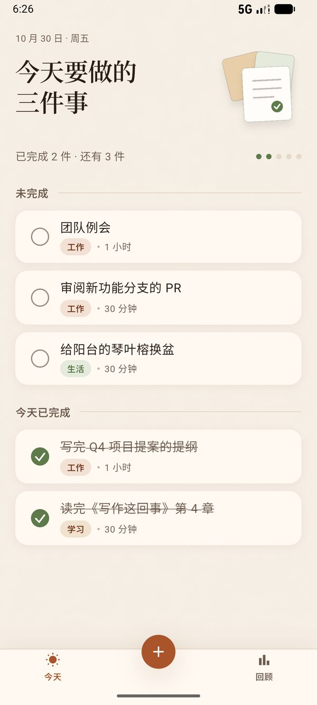
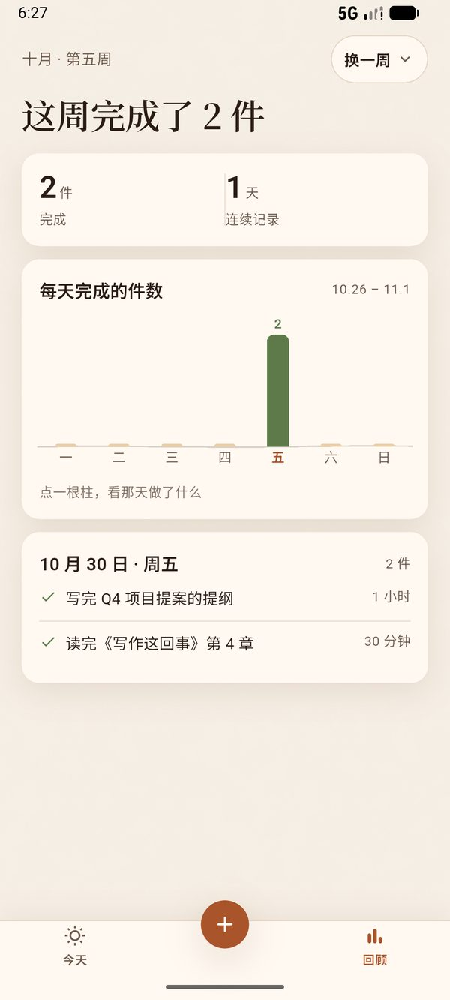
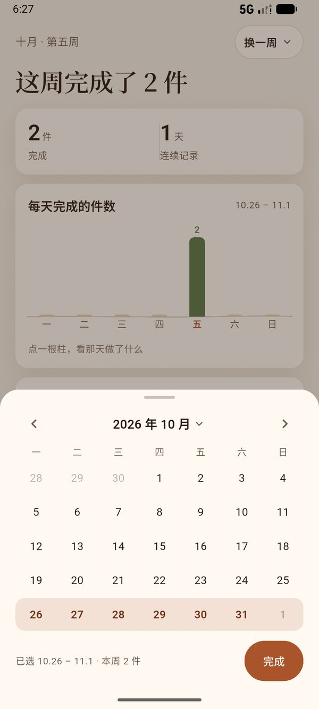
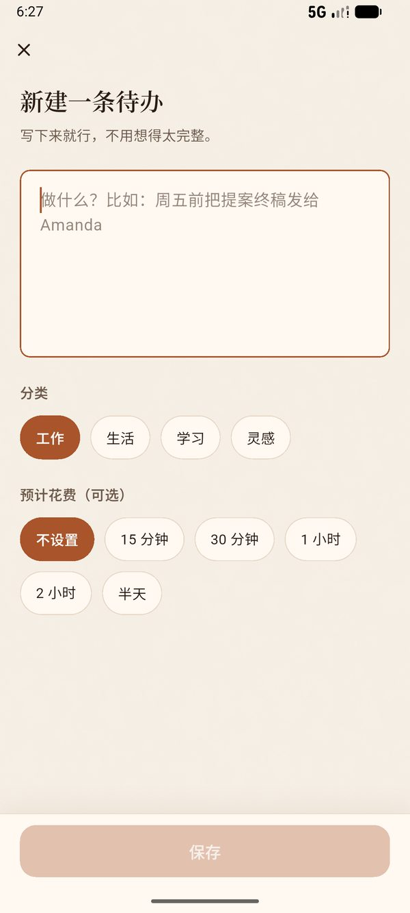
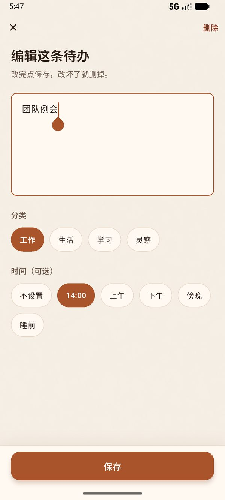
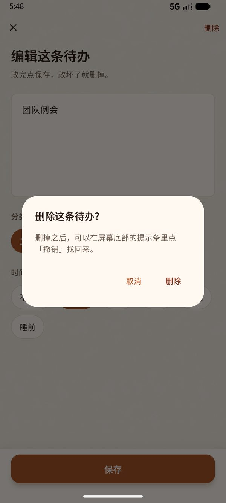
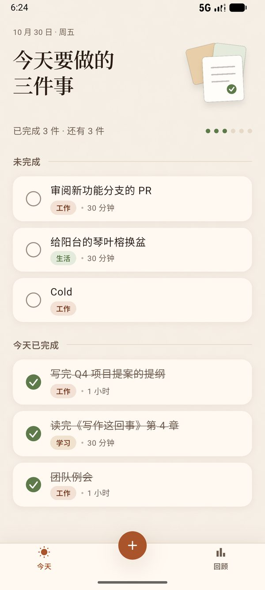
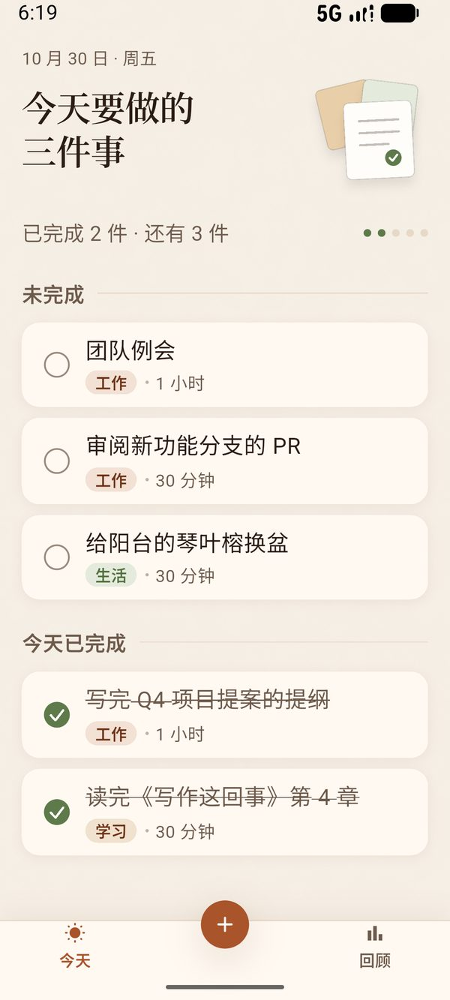
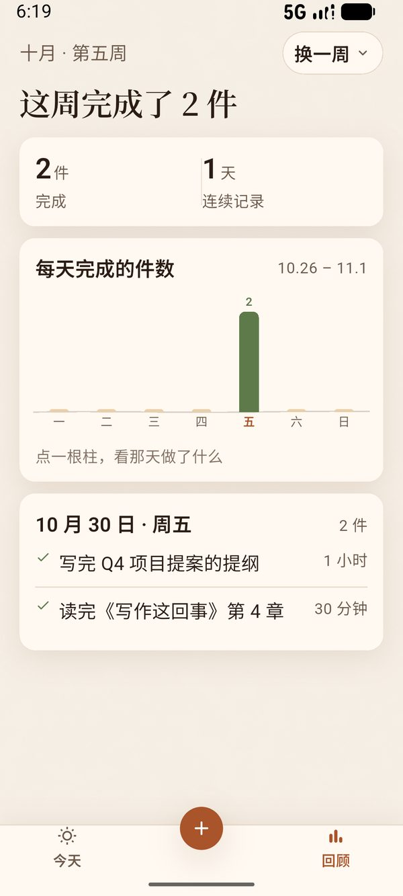
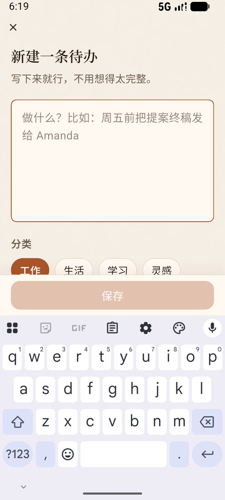

# 今天 · 纸感待办

一个安安静静记待办的 Android App。暖纸底色、衬线大标题、手绘感勾选圈；打开就是「今天」，第二页是这一周的节奏。

界面照 `design/` 下四张高保真原型落地，纯 Flutter，没有后端、没有账号，数据只存在手机上。

<p>
  
  
  
</p>

## 能做什么

- **今天**：未完成、今天已完成两段；点勾选圈完成/取消，点整行进编辑；顶部按件数报数，右侧进度点一眼看完。
- **新建 / 编辑**：同一个页面，标题、分类（工作 / 生活 / 学习 / 灵感）、预计花费（15 分钟 / 30 分钟 / 1 小时 / 2 小时 / 半天）药丸选择；保存按钮在内容为空时禁用。
- **删除**：二次确认，删完提示条里可以撤销，原 id、完成时间都还原。
- **回顾**：这周完成件数、连续记录天数、每天完成的柱状图（点柱子看当天明细）；「换一周」月历按周选，点标题还能直接跳年月。
- **持久化**：每次改动落盘，杀进程重开数据、完成状态都在。

<p>
  
  
  
</p>

## 跑起来

```bash
flutter pub get
flutter run          # 真机或模拟器，Android 7.0（minSdk 24）及以上
flutter test         # 55 例
flutter analyze
```

首次启动且本地没有数据时，会写入 5 条示例待办（`lib/data/seed_data.dart` 的 `kSeedDemoOnFirstRun`）。清掉重来：

```bash
adb shell pm clear io.github.yokijiudai.paper_todo
```

## 结构

```
lib/
├─ main.dart               runApp、路由、冷启动读盘
├─ theme/                  tokens（颜色/字号/间距/阴影）与 ThemeData
├─ models/todo_note.dart   不可变模型 + JSON
├─ data/                   SharedPrefsTodoStore / MemoryTodoStore、示例数据
├─ state/todo_controller.dart  增删改查 + 派生「未完成 / 今天已完成 / 周计数 / 连续天数」
├─ screens/                root_shell / home / note_form / stats
├─ utils/formatters.dart   日期、周次、中文数字
└─ widgets/                paper_scaffold、note_tile、check_circle、category_chip、
                           diy_tabbar、hero_notes_art、day_bar_chart、week_sheet
```

分层是 `screens → widgets / state → data → models`，`widgets` 不 import `screens` 和 `data`；页面只订阅 `TodoScope`，业务判断都在 controller 里。

## 技术选择

| 事项 | 做法 | 为什么 |
|---|---|---|
| 状态管理 | `ChangeNotifier` + `InheritedNotifier`（`TodoScope`） | 一个 App 一个 controller，引状态库只会多一层 |
| 持久化 | `shared_preferences` 存一段 JSON（key `todo.notes.v1`） | 数据量小、要「杀掉再开还在」；JSON 整段读写够用，也方便以后换文件/数据库 |
| 图表 / 月历 | `CustomPainter` 自绘、`showModalBottomSheet` 自建 | 原型的手绘基线、按周选中这些交互，现成图表库反而难改 |
| 插画 | `CustomPainter` 画三张旋转便签 | 精确控制层叠角度与阴影，不必引 `flutter_svg` |
| 衬线字体 | 子集化的 Noto Serif SC SemiBold（163 KB） | 完整字体 11.8 MB；衬线只用在固定标题和数字上，用户输入走无衬线 |
| 主题 | 全部尺寸/颜色集中在 `theme/tokens.dart` | 对着 `design/tokens.css` 一比一抄，改一处全站生效 |

### 数据长这样

```json
{
  "version": 1,
  "notes": [
    {
      "id": "m3kq9x1",
      "content": "团队例会",
      "category": "work",
      "estimate": "1 小时",
      "createdAt": "2026-10-30T01:20:00.000",
      "completedAt": "2026-10-30T03:05:00.000"
    }
  ]
}
```

`completedAt` 为 `null` 即未完成，`isCompleted` 是派生 getter；未知 `category` 回落 `work`；旧版本写过 `timeLabel` 的条目仍能读进来（`estimate ?? timeLabel`），不会被静默改写。

## 验收

八项验收清单（无溢出、可点区、勾选同步、跨月周切换、空态、冷启动、字号 1.3 倍、`analyze` + `test`）在模拟器与测试里逐项验过。这里留两组「光看代码看不出来」的证据。

**冷启动**：清数据 → 勾掉一条 → 新建一条 → `adb shell am force-stop` → 重开。截图里「团队例会」已经落到「今天已完成」，新条目在未完成里，计数「已完成 3 件 · 还有 3 件」——说明落盘与首启种子都对得上。（新条目是 adb 敲的 ASCII 文本，adb 打不了中文。）

<p>
  
</p>

**系统字号 1.3 倍**：把模拟器 `font_scale` 调到 1.3 后逐页看——首页标题折成两行、卡片变高但不出框；回顾页的卡片标题和日期范围不打架；表单在键盘弹起时保存栏仍贴着键盘。

<p>
  
  
  
</p>

其余六项（390×844 无溢出、可点区 ≥44、勾选后两页同步、跨月周切换、三处空态、`analyze` + `test`）由 55 例测试和真机点按覆盖，不单独截图。

## 资产

- **字体**：完整字体放 `build/fontsrc/`（不进仓库），`python tool/subset_font.py` 按 `lib/` 里出现的字裁子集到 `assets/fonts/`。**改了标题文案要重跑**，否则新字会回落到系统衬线。
- **纸纹**：`python tool/gen_paper_texture.py` 生成 256×256 可平铺噪声，整屏 7% 叠加。
- **README 截图**：`python tool/make_readme_shots.py` 把 `build/preview/` 的真机截图压成 `docs/screenshots/*.jpg`。

## 构建

```bash
flutter build apk --release                    # 单包约 48.5 MB（含全部 ABI）
flutter build apk --release --split-per-abi    # 按 ABI 拆，单包会小很多
```

目前 release 用的是 debug 签名（Flutter 模板默认），要发布请换成自己的 keystore。Android 之外的平台没验证过。

## 许可

代码使用 [BSD 3-Clause](LICENSE)；字体、图标等第三方资源的来源与许可见 [THIRD_PARTY_NOTICES.md](THIRD_PARTY_NOTICES.md)。

## 已知边界

- 没有云同步、没有提醒通知、没有多设备——这是「本地小工具」的取舍。
- 涨到几千条时整段 JSON 读写会变慢；到那天把 `TodoStore` 换成文件或数据库实现即可，controller 与 UI 不用动。
- 所有统计都按设备本地时间算「今天」「本周」，跨时区旅行时边界会跟着变。